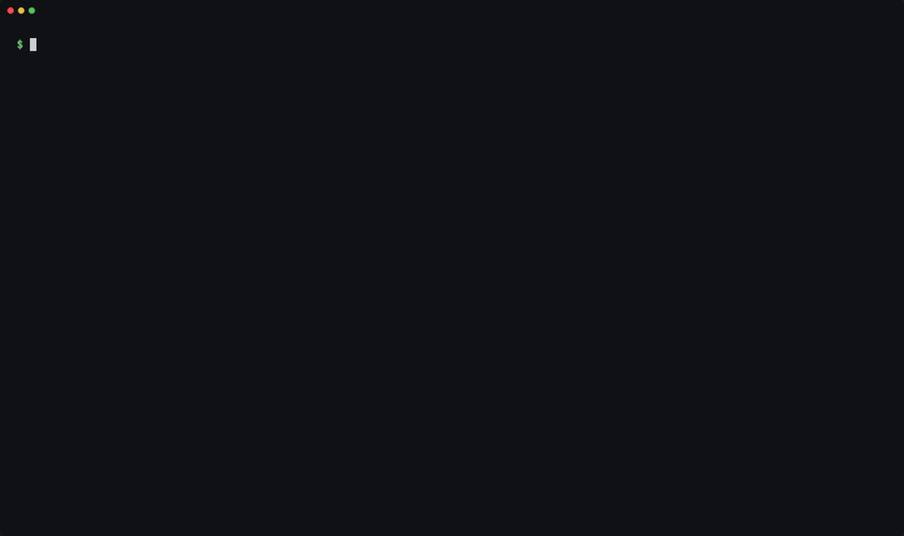

# Redocly CLI

**Govern your APIs with one tool.**
Lint, bundle, test, document, and generate clients from the command line.

[](https://www.npmjs.com/package/@redocly/cli)
[](https://www.npmjs.com/package/@redocly/cli)
[](LICENSE.md)
[](https://github.com/Redocly/redocly-cli/actions/workflows/tests.yaml)

<picture>
  <source media="(prefers-color-scheme: dark)" srcset="./media/lifecycle-dark.svg">
  
</picture>

Redocly CLI is a fast OpenAPI linter and API governance toolkit.
It checks OpenAPI 3.2, 3.1, 3.0, Swagger 2.0, AsyncAPI 3.x and 2.6, and Arazzo 1.x descriptions against your API style guide.
It runs on your machine, in CI/CD, and in Docker.

## Quick start

Run the latest version without installing it:

```sh
npx @redocly/cli@latest lint openapi.yaml
```

Or install it with npm or Docker.

### npm

```sh
npm install -g @redocly/cli
```

### Docker

```sh
docker run --rm -v $PWD:/spec redocly/cli lint openapi.yaml
```

npm and npx need Node.js 22.12.0 and npm 10.9.2 or later.
For more options, see [Install Redocly CLI](https://redocly.com/docs/cli/installation).

## What you can do

Lint, design tests with AI, and test the live API:



### Lint to your API style guide

Mix and match the [built-in rules](https://redocly.com/docs/cli/rules/built-in-rules) to set your API guidelines.
When you need a rule of your own, write it in `redocly.yaml`.
[Configurable rules](https://redocly.com/docs/cli/rules/configurable-rules) use simple expressions that know the structure of the API description, not complex JSONPath selectors.
For full control, [build your own plugin](https://redocly.com/docs/cli/custom-plugins).

```yaml
extends:
  - recommended
rules:
  operation-summary: error
  rule/operation-id-camel-case:
    subject:
      type: Operation
      property: operationId
    assertions:
      casing: camelCase
    message: operationId must be camelCase.
```

**Multiple files supported.**
You do not need to bundle your API description to lint it.
Point Redocly CLI at the entry point, for example `openapi.yaml`, and it follows every `$ref`.

```sh
redocly lint openapi.yaml
```

The default output is `codeframe`.
Other tools can read the `stylish`, JSON, Markdown, Checkstyle, JUnit, and other formats.
Moving from Spectral?
Read [Migrate from Spectral](https://redocly.com/docs/cli/guides/migrate-from-spectral).

[Learn more about API standards and how to configure rules](https://redocly.com/docs/cli/api-standards).
For ready-made rules and plugins, see the [Cookbook](./cookbook/README.md).

### Bundle, split, and join

Keep a large description in many files, and bundle it into one file for tools that need it.
Use [decorators](https://redocly.com/docs/cli/decorators) to remove internal endpoints or change server URLs as you bundle.

```sh
redocly bundle openapi.yaml -o dist/openapi.yaml
```

### Test the live API

[Respect](https://redocly.com/docs/respect/get-started) sends real requests to your API and checks each response against your OpenAPI description and Arazzo workflows.
With `--with-ai`, your local AI CLI (Claude, Codex, or Cursor) designs multi-step workflows from the OpenAPI description.

```sh
redocly generate-arazzo openapi.yaml --with-ai
redocly respect auto-generated.arazzo.yaml
```

### Build API reference docs

Make a single HTML page of API reference docs with [Redoc CE](https://redocly.com/redoc-ce).

```sh
redocly build-docs openapi.yaml
```

### Generate typed clients (experimental)

Generate a TypeScript client with zero runtime dependencies, or SDKs for Python, Go, PHP, and Java.
Flags, output, and configuration can change in any minor release until the feature is stable.

```sh
redocly generate-client openapi.yaml --output src/client.ts
```

Read the [`generate-client` docs](https://redocly.com/docs/cli/commands/generate-client).

### Compare versions and traffic (experimental)

[`diff`](https://redocly.com/docs/cli/commands/diff) lists the changes between two versions of a description.
[`drift`](https://redocly.com/docs/cli/commands/drift) compares recorded HTTP traffic with the description.

See [all commands](https://redocly.com/docs/cli/commands).

## Use with AI assistants

Redocly CLI ships [agent skills](./.claude/skills) that teach AI coding assistants how to use it.
This command finds Claude Code, Codex, Cursor, GitHub Copilot, and other agents, and installs the skills into your project:

```sh
redocly skills
```

It installs only the skills for Redocly CLI.
To install every skill that Redocly publishes, use `npx skills add https://redocly.com`.

- `redocly-cli`: lint, bundle, decorate, build docs, test, and generate a client.
- `redocly-lint-rules`: turn a rule written in plain language into a built-in rule, a configurable rule, or a plugin.
  It also moves rules from other linters, such as Spectral.
- `recheck-lint`: run `redocly recheck` on the Markdown that the assistant changed, and fix what it finds.
- `recheck-config`: write and tune the `recheck` settings in `redocly.yaml`.

## Migrate

- [From Redocly CLI v1 to v2](https://redocly.com/docs/cli/guides/migrate-to-v2)
- [From Spectral](https://redocly.com/docs/cli/guides/migrate-from-spectral)
- From [swagger-cli](https://redocly.com/docs/cli/guides/migrate-from-swagger-cli), [redoc-cli](https://redocly.com/docs/cli/guides/migrate-from-redoc-cli), or [openapi-cli](https://redocly.com/docs/cli/guides/migrate-from-openapi-cli)

## From the CLI to a full API platform

<a href="https://redocly.com/pricing">
  <picture>
    <source media="(prefers-color-scheme: dark)" srcset="./media/platform-dark.svg">
    
  </picture>
</a>

See [plans and pricing](https://redocly.com/pricing).
To work on a Redocly Framework project locally, run [`redocly preview`](https://redocly.com/docs/cli/commands/preview).
Add `--plan=pro`, `--plan=scale`, or `--plan=enterprise` to see the features of that plan.

## Data collection

This tool [collects data](./docs/@v2/usage-data.md) to help Redocly improve our products and services.
You can opt out by setting the `REDOCLY_TELEMETRY` environment variable to `off`.

## Update notifications

Redocly CLI checks for updates on startup.
You can disable notifications by setting the `REDOCLY_SUPPRESS_NOTIFICATIONS` environment variable to `true`.

## More resources

[Read the detailed docs](https://redocly.com/docs/cli/).

## Credits

Thanks to [graphql-js](https://github.com/graphql/graphql-js) and [eslint](https://github.com/eslint/eslint) for inspiration of the API description traversal approach and to [Swagger](https://github.com/swagger-api/swagger-editor), [Spectral](https://github.com/stoplightio/spectral), and [OAS-Kit](https://github.com/Mermade/oas-kit) for inspiring the recommended ruleset.

## Development

Contributions are welcome!
All the information you need is in [CONTRIBUTING.md](CONTRIBUTING.md).
