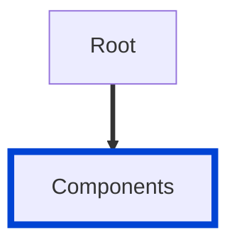

# no-ambiguous-component-names

Ensures that component names in the same `components` section do not differ only in letter case or in the `-`, `_`, and `.` characters.

The rule compares names after it removes `-`, `_`, and `.` and converts the rest to lowercase.
For example, `MenuItem`, `menuItem`, `menu-item`, `menu_item`, `Menu.Item`, and `MENUITEM` all become `menuitem`, so the rule reports all of them except the first one.

The rule checks each section on its own.
A schema named `OrderId` and a parameter named `order-id` do not conflict.

| OAS | Compatibility |
| --- | ------------- |
| 2.0 | ❌            |
| 3.0 | ✅            |
| 3.1 | ✅            |
| 3.2 | ✅            |



## API design principles

Many tools turn component names into identifiers.
Code generators convert them to class or type names, and documentation tools convert them to anchors and file names.
These conversions often change the letter case and drop separators, so `menu-item` and `MenuItem` can both become `MenuItem`.
The result is a name collision: one of the generated types overwrites the other, gets a numeric suffix, or the build fails.
Names that differ only in case also collide on case-insensitive file systems.

Pick one spelling for each concept so that every tool produces a distinct name.

## Configuration

| Option   | Type   | Description                                                                               |
| -------- | ------ | ----------------------------------------------------------------------------------------- |
| severity | string | Possible values: `off`, `warn`, `error`. Default `warn` (in `recommended` configuration). |

An example configuration:

```yaml
rules:
  no-ambiguous-component-names: error
```

## Examples

Given this configuration:

```yaml
rules:
  no-ambiguous-component-names: error
```

Example of **incorrect** component names:

```yaml
components:
  schemas:
    MenuItem:
      type: object
    menu_item:
      type: object
```

Example of **correct** component names:

```yaml
components:
  schemas:
    MenuItem:
      type: object
    MenuItemList:
      type: object
```

## Related rules

- [component-name-unique](./component-name-unique.md)
- [spec-components-invalid-map-name](./spec-components-invalid-map-name.md)

## Resources

- [Rule source](https://github.com/Redocly/redocly-cli/blob/main/packages/core/src/rules/oas3/no-ambiguous-component-names.ts)
- [Components docs](https://redocly.com/docs/openapi-visual-reference/components/)
